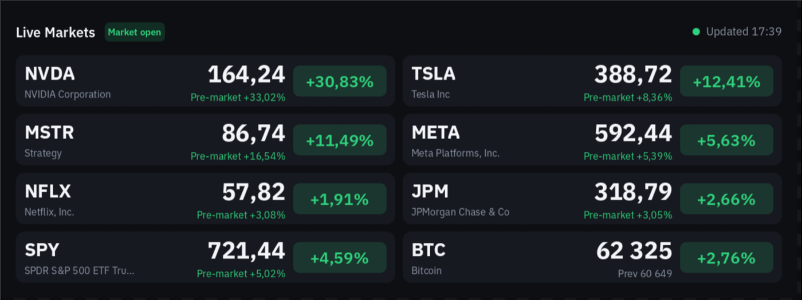
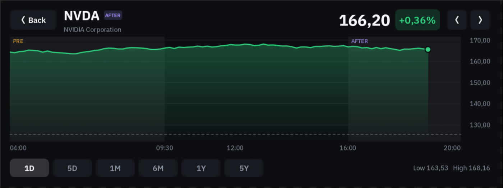

# Live Markets · Braiins Deck widget

Prices that follow the market, for a watchlist you choose: US stocks and ETFs with their **pre-market
and after-hours** moves, indexes, gold and crypto. Tap a symbol to see its **chart** and change the time
frame. It asks for new prices every two seconds while a market is open.



## Screens

**The list.** One cell per symbol: the price, the move as a colored pill, and a line under the price that
depends on the session.

| Session (New York time) | The price | The move | The line under it |
| --- | --- | --- | --- |
| Pre-market, 4:00 to 9:30 | the pre-market trade | against the previous close | `Prev 125.53` |
| Regular hours, 9:30 to 16:00 | the last trade | against the previous close | `Pre-market +33.08%`, how it traded before the open |
| After hours, 16:00 to 20:00 | the after-hours trade | against the close | `Close 165.60 +31.92%`, the day's own close and move |
| Closed | the last after-hours trade | against the close | the same |

A `PRE` or `AFTER` tag, and the chip in the header (`Pre-market`, `Market open`, `After hours`,
`Market closed`), say which session it is. A price flashes green or red when it ticks. Coins and gold
have no extended hours, so they show the plain day. Indexes have none either: for pre-market and
after-hours moves of the market, watch `SPY` or `QQQ`.


**The chart.** Tap a symbol. The chart has the price now as its last point, a grid of round prices, and
for a day or five days the pre-market and after-hours stretches shaded and named. A dashed line marks the
previous close. Buttons choose the time frame: 1D, 5D, 1M, 6M, 1Y and 5Y (a coin has 2D in place of 5D,
because the service keeps two days of its minutes). The arrows beside the price step to the next and the
previous symbol; Back returns to the list, and so does ninety seconds without a tap.

**Reading the price at a time.** Put a finger on the chart and keep it there, sliding along. A cursor
follows the finger and the header shows the price at that moment, its time, and its move since the
frame began (since the previous close, on a day). A pre-market or after-hours moment is tagged as such.
Lift the finger and the live price comes back.




**Sizes.** The widget takes any size from 317 × 238 to the full 1280 × 480. The list picks its columns
from the room there is, and a tile too small for every symbol turns the pages by itself, eight seconds a
page. Type sizes are fixed per size band, never scaled. In a narrow cell the session tag becomes a dot of
its color.

## Data

- Prices come from CNBC's public quote service (`quote.cnbc.com`), charts from its chart service
  (`ts-api.cnbc.com`). **Neither is an official, documented feed**, and either can change or stop. The
  widget says so when it cannot read a reply, and keeps what it last had, dimmed after a minute without news.
- One request per update for the whole list, every `Update every` seconds (default 2) while any symbol
  trades, every 30 seconds when all are closed. The widget asks only while it is on screen.
- A chart is fetched when you open it, and again every 30 seconds (day), a minute (five days) or five
  minutes (longer), only while it is open. The reply is cut to at most 240 points.
- Nothing is stored on the Deck, and there is no account or key: both services answer anyone. They refuse
  a client that does not say what it is, so the widget sends its own `User-Agent`.

## Setup

1. Install it on the Deck (see below).
2. In the Deck's web interface, add **Live Markets** to a scene.
3. In its settings, list the symbols, in the order you want them (up to 12), and pick the update speed.

Symbols are written as on a stock exchange: `NVDA`, `AAPL`, `SPY`, `BRK.B` (or `BRK-B`). Coins are
`BTC-USD`, `ETH-USD`, `SOL-USD`. Indexes are `^GSPC`, `^IXIC`, `^DJI`, `^NDX`, `^RUT`; gold is `XAU-USD`
(its quote is delayed). A name the service does not know shows `No data`, so a typo is easy to see.

## Install and build

Needs rustup (`rust-toolchain.toml` picks Rust 1.97.1 with the wasm target) and the SDK, which is the
submodule `bmc-sdk/`, pinned to the revision the Deck's firmware 26.10.1 was built from:

```bash
git submodule update --init
cargo build --manifest-path bmc-sdk/Cargo.toml -p bmc-wasm-assets     # once: the packaging tool
./deploy.sh <deck-ip>        # builds, packages and installs; ./undeploy.sh <deck-ip> removes it
```

`deploy.sh` packages the widget as the firmware's own build does and adds it with the Deck's package
manager, which needs the SSH key login (`ssh-copy-id root@<deck-ip>` once). Re-running replaces the
installed version; raise `version` in `live-markets/manifest.json` for an update.

## Develop

The logic is in plain modules that the tests run on the Mac: `symbols` (what is typed and what the service
calls it), `quote` (which price and move each session shows), `chart` (bars to points, bands and labels),
`state` (the watchlist, the screen, taps) and `view` (the screens and where their buttons are). Only the
glue in `lib.rs` touches the host.

```bash
cargo test -p live-markets --target aarch64-apple-darwin     # use your Mac's target
cargo clippy -p live-markets --target wasm32-unknown-unknown
```

To see it on a Mac, build the SDK's desktop testbed once, then run any screen, with the live markets or
with sample data for a session or a time frame that is not on right now (`live-markets/src/preview.rs`).
`tools/shot.sh` builds the sample, shows it in the testbed and saves that window alone as a PNG (it
never captures the whole screen):

```bash
cargo build --manifest-path bmc-sdk/Cargo.toml -p bmc-wasm-runtime --features testbed --bin testbed
tools/shot.sh live /tmp/live.png          # the real markets
tools/shot.sh post /tmp/after.png         # sample: pre, post, closed, offline
tools/shot.sh chart:5D /tmp/chart.png     # sample: chart:1D, chart:1D:post, chart:1M, chart:6M, chart:1Y, chart:5Y
```

## Notes

- The pre-market and after-hours logic works from the fields CNBC reports for them: the quote's session,
  and the extended-hours trade it carries. The move of an extended trade is worked out from the prices
  (against the previous close before the open, against the close after it), so it does not depend on which
  base the service chose. Regular hours were checked against the live service; the two extended sessions
  were checked against fixtures and sample data, and need a look at 4:00 or 16:00 New York time.
- A chart marks a stock's sessions by the exchange's clock, which the service sends with every bar.
- Taps go to one transparent area over the screen and are read against the buttons that were on screen
  when the finger came down, so a screen that changes under a finger cannot press the wrong button.
- The chart is a touch area of its own, and the Deck gives a finger to the smallest area it lands in, so a
  finger held on the chart is followed there (even when it slides past the chart's edge) and never presses
  a button. The sample screens can show a cursor: `tools/shot.sh chart:1D:post:43 out.png` puts it 43 % along.

## License

GPL-3.0-or-later; see [COPYING](COPYING). The widget is built with the Braiins Deck SDK, which is
GPL-3.0-or-later too. It is not made by or affiliated with Braiins, CNBC or anyone whose prices it shows.
