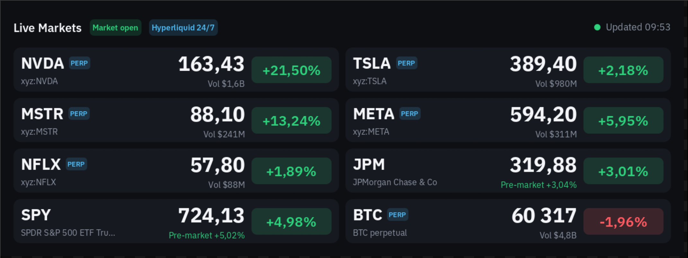
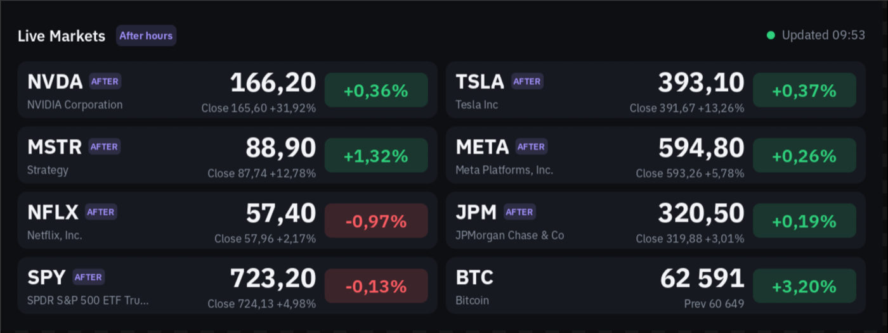
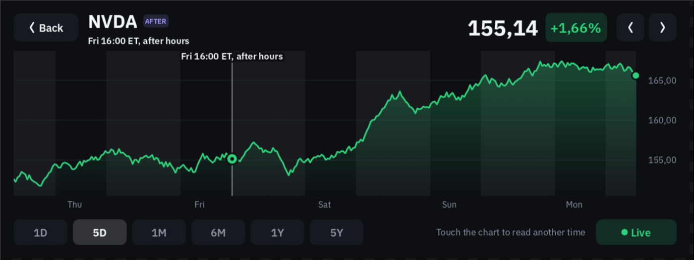
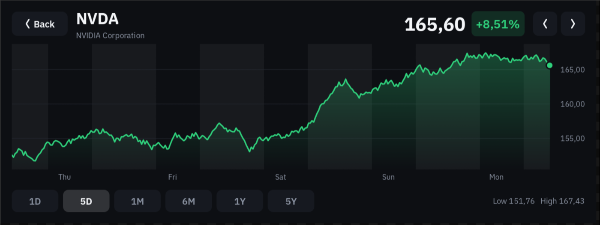
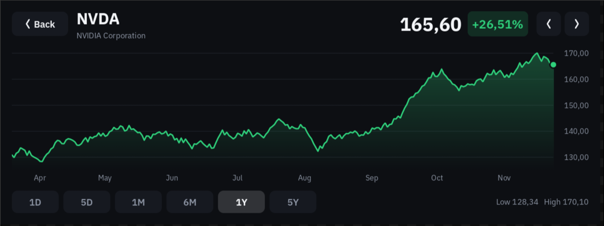
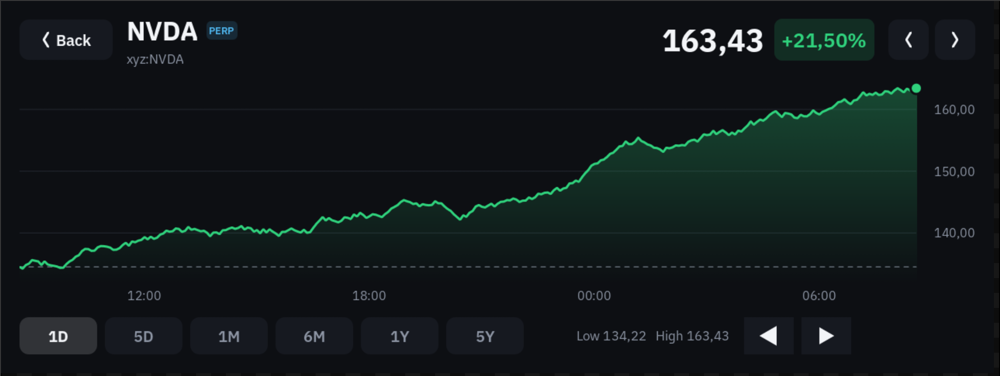
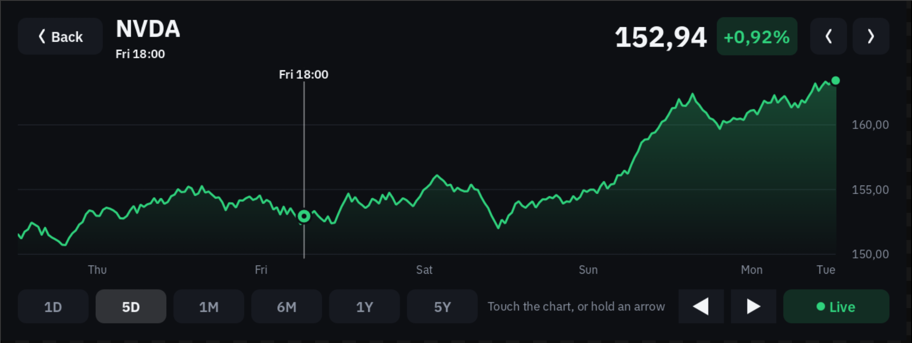

# Live Markets · Braiins Deck widget

Prices that follow the market, for a watchlist you choose. By default they come from **Hyperliquid**,
whose markets never close: crypto, and the stocks, indexes and gold that its builders list there as
perpetuals, pushed every second, night and weekend too. What Hyperliquid has no market for comes from
**CNBC**, with the **pre-market and after-hours** moves of US stocks. Tap a symbol to see its **chart**
and change the time frame.



## Two sources

| | Hyperliquid (the default) | CNBC |
| --- | --- | --- |
| What | Perpetuals: crypto, and the stocks, indexes and gold that builders list (`xyz:NVDA`) | Stocks, ETFs, indexes, gold, coins |
| Hours | Round the clock, weekends too | US stock hours, with pre-market and after-hours |
| The move | Against the price 24 hours ago | Against the previous close |
| New prices | Pushed over a socket, about once a second | A request every 2 seconds (every 30 when closed) |
| Tag | `PERP`, and the volume of the day under the price | `PRE`, `AFTER`, or none |

A perpetual follows the price of its asset but is not that asset: `xyz:NVDA` is not NVIDIA's price on
the Nasdaq, and at the weekend it keeps moving while the exchange is shut. Each symbol takes its price
from the first place that has it: Hyperliquid's main market (`BTC`, `ETH`), then the builder market
`xyz` (`NVDA`, `TSLA`, `GOLD`), and CNBC when neither does (`JPM`, `SPY`, `^DJI`). The header says
`Hyperliquid 24/7` when any price on screen comes from there, and `Market open`, `Pre-market`,
`After hours` or `Market closed` for the symbols of CNBC's. If Hyperliquid cannot be reached, CNBC
prices its symbols until it can.


## Screens

**The list.** One cell per symbol: the price, the move as a colored pill, and a line under the price that
depends on the session.

| Session (New York time) | The price | The move | The line under it |
| --- | --- | --- | --- |
| Pre-market, 4:00 to 9:30 | the pre-market trade | against the previous close | `Prev 125.53` |
| Regular hours, 9:30 to 16:00 | the last trade | against the previous close | `Pre-market +33.08%`, how it traded before the open |
| After hours, 16:00 to 20:00 | the after-hours trade | against the close | `Close 165.60 +31.92%`, the day's own close and move |
| Closed | the last after-hours trade | against the close | the same |

A `PRE` or `AFTER` tag, and the chip in the header (`Pre-market`, `Market open`, `After hours`,
`Market closed`), say which session it is. The chip goes by the New York clock and the weekdays, with
summer time, and does not know the exchange's holidays. A price flashes green or red when it ticks. Coins and gold
have no extended hours, so they show the plain day. Indexes have none either: for pre-market and
after-hours moves of the market, watch `SPY` or `QQQ`.



**The chart.** Tap a symbol. The chart has the price now as its last point, a grid of round prices, and
for a day or five days the pre-market and after-hours stretches shaded and named. A dashed line marks the
previous close. For a perpetual a day is the last 24 hours, in five-minute candles from Hyperliquid, with
labels at round hours of the Deck's own clock, and the dashed line is the price 24 hours ago. Buttons choose the time frame: 1D, 5D, 1M, 6M, 1Y and 5Y (a coin has 2D in place of 5D,
because the service keeps two days of its minutes). The arrows beside the price step to the next and the
previous symbol; Back returns to the list, and so does ninety seconds without a tap.

**Reading the price at a time.** Touch the chart where you want to know the price. A cursor jumps to that
moment and stays there, and the header shows the price then, its time, and its move since the frame began
(since the previous close, on a day). Touch somewhere else to move it. The Live button, or fifteen seconds
without a touch, brings the live price back. A pre-market or after-hours moment is tagged as such.

To sweep along the chart, **hold one of the two triangles** (bottom right on the full screen, over the foot
of the chart on the half-height tile): the cursor moves a notch as the finger comes down, then runs along the
chart, faster the longer it is held, and stops where you let go. The chevrons beside the price are different:
they step to the next symbol.

Why touch and hold, and not slide? The Deck turns any horizontal slide of more than 15 pixels (under 2 mm on
its screen) into a swipe to the next scene, cancels the widget's touch, and gives a widget no way to opt out:
it is decided in the firmware's compositor (`touch_gesture.rs` and `egl_compositor.rs` in `bmc-main`), and
only a layout with a single scene, or a system overlay, switches it off. Sliding along the chart would
therefore swipe the scene away. A widget that could claim a horizontal drag would need a change in the
firmware; until then the chart is read by touching it and by holding the triangles.












**Sizes.** The widget takes any size from 317 × 238 to the full 1280 × 480. The list picks its columns
from the room there is, and a tile too small for every symbol turns the pages by itself, eight seconds a
page. Type sizes are fixed per size band, never scaled. In a narrow cell the session tag becomes a dot of
its color.

## Data

- **Hyperliquid** (`api.hyperliquid.xyz`). Prices arrive on one WebSocket connection that subscribes to
  the market of each symbol (`activeAssetCtx`): the mark price, the price 24 hours ago and the volume of
  the day, about once a second each. A chart is a `candleSnapshot` request (5-minute candles for a day,
  30-minute for five days, 4-hour for a month, daily for 6 months and a year, weekly for 5 years), cut to
  at most 240 points. A name the exchange does not have is refused, and the symbol goes to CNBC.
- **CNBC** (`quote.cnbc.com`, `ts-api.cnbc.com`): one request per update for the symbols that come from it,
  every `Update every` seconds (default 2) while any trades, every 30 seconds when all are closed.
- **Neither is an official feed for this widget**, and either can change or stop. The widget says so when
  it cannot read a reply, and keeps what it last had, dimmed after a minute without news.
- A chart is fetched when you open it, and again every 30 seconds (day), a minute (five days) or five
  minutes (longer), only while it is open.
- The widget asks for nothing, and closes the connection, while it is off screen.
- Nothing is stored on the Deck, and there is no account or key: both services answer anyone. CNBC
  refuses a client that does not say what it is, so the widget sends its own `User-Agent`.
- **A WebSocket without the Deck's WebSocket call.** The Deck's own WebSocket call is built without TLS, so
  it cannot open `wss://` addresses. The widget opens a verified TLS socket, which the Deck does offer, and
  speaks the WebSocket protocol on it: the upgrade request, masked frames out, frames in, pongs for pings
  (`live-markets/src/ws.rs`, with its tests).

## Setup

1. Install it on the Deck (see below).
2. In the Deck's web interface, add **Live Markets** to a scene.
3. In its settings, list the symbols, in the order you want them (up to 12), choose where the prices come
   from (Hyperliquid, or CNBC for the whole list) and pick the update speed of CNBC's.

Symbols are written as on a stock exchange: `NVDA`, `AAPL`, `SPY`, `BRK.B` (or `BRK-B`). Coins are
`BTC-USD`, `ETH-USD`, `SOL-USD`. Indexes are `^GSPC`, `^NDX`, `^VIX`, `^DJI`, `^RUT`; gold is `XAU-USD`
(`GOLD` on Hyperliquid, delayed on CNBC). A name that neither service knows shows `No data`, so a typo is
easy to see.

Two prefixes choose the market: `xyz:NVDA` asks for one coin exactly as Hyperliquid names it (a builder's
market, such as `xyz:`, `flx:`, `km:` or `cash:`, then the name), and `cnbc:NVDA` asks CNBC for that symbol
and not Hyperliquid.

## Install and build

Needs rustup (`rust-toolchain.toml` picks Rust 1.97.1 with the wasm target) and the SDK, which is the
submodule `bmc-sdk/`, pinned to the revision the Deck's firmware 26.10.1 was built from:

```bash
git submodule update --init
cargo build --manifest-path bmc-sdk/Cargo.toml -p bmc-wasm-assets     # once: the packaging tool
./deploy.sh <deck-ip>        # builds, packages and installs; ./undeploy.sh <deck-ip> removes it
```

`deploy.sh` packages the widget as the firmware's own build does and adds it with the Deck's package
manager, which needs the SSH key login (`ssh-copy-id root@<deck-ip>` once). Re-running replaces the
installed version; raise `version` in `live-markets/manifest.json` for an update.

## Develop

The logic is in plain modules that the tests run on the Mac: `symbols` (what is typed and what each service
calls it), `quote` (which price and move each session shows), `hl` (Hyperliquid's messages and candle
requests), `ws` (the WebSocket protocol over a plain byte stream), `chart` (bars to points, bands and
labels), `state` (the watchlist, the sources, the screen, taps) and `view` (the screens and where their
buttons are). Only the glue in `lib.rs` touches the host.

```bash
cargo test -p live-markets --target aarch64-apple-darwin     # use your Mac's target
cargo clippy -p live-markets --target wasm32-unknown-unknown
```

To see it on a Mac, build the SDK's desktop testbed once, then run any screen, with the live markets or
with sample data for a session or a time frame that is not on right now (`live-markets/src/preview.rs`).
`tools/shot.sh` builds the sample, shows it in the testbed and saves that window alone as a PNG (it
never captures the whole screen):

```bash
cargo build --manifest-path bmc-sdk/Cargo.toml -p bmc-wasm-runtime --features testbed --bin testbed
tools/shot.sh live /tmp/live.png          # the real markets
tools/shot.sh post /tmp/after.png         # sample: pre, post, closed, offline
tools/shot.sh hl /tmp/hl.png              # sample: the list as Hyperliquid and CNBC share it
tools/shot.sh chart:5D /tmp/chart.png     # sample: chart:1D, chart:1D:post, chart:1M, chart:6M, chart:1Y, chart:5Y
tools/shot.sh chart:1D:hl /tmp/perp.png   # sample: the chart of a perpetual (add :35 for a cursor)
tools/shot.sh livechart:1D /tmp/c.png     # the real markets, with the first symbol's chart open
```

## Notes

- Hyperliquid's reply to a name it has no market for is a message on the socket, and that is how a symbol is
  found to belong to CNBC: `JPM` and `SPY` are refused a second after the connection opens, and shown from
  CNBC. A market that was accepted but never sends a price is handed to CNBC after 15 seconds, and
  silence from the whole connection for 20 seconds hands everything to CNBC until it speaks again.
- The pre-market and after-hours logic works from the fields CNBC reports for them: the quote's session,
  and the extended-hours trade it carries. The move of an extended trade is worked out from the prices
  (against the previous close before the open, against the close after it), so it does not depend on which
  base the service chose. Regular hours were checked against the live service; the two extended sessions
  were checked against fixtures and sample data, and need a look at 4:00 or 16:00 New York time.
- A chart marks a stock's sessions by the exchange's clock, which the service sends with every bar.
- Taps go to one transparent area over the screen and are read against the buttons that were on screen
  when the finger came down, so a screen that changes under a finger cannot press the wrong button.
- The chart is a touch area of its own, and the Deck gives a finger to the smallest area it lands in, so
  a touch on the chart moves the cursor and never presses a button, while a touch anywhere else goes to the
  screen-wide tap area. A touch so quick that it is over between two frames still moves the cursor (it
  arrives as a click). The sample screens can show a cursor: `tools/shot.sh chart:5D:regular:35 out.png`
  puts it 35 % along.

## License

GPL-3.0-or-later; see [COPYING](COPYING). The widget is built with the Braiins Deck SDK, which is
GPL-3.0-or-later too. It is not made by or affiliated with Braiins, CNBC, Hyperliquid or anyone whose
prices it shows. Perpetuals are derivatives: this is a display, not advice.
